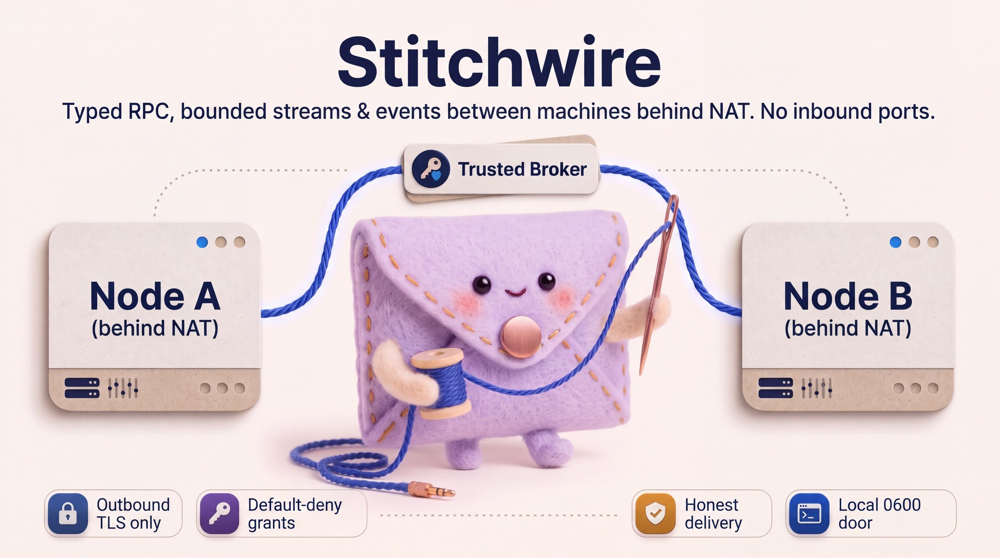
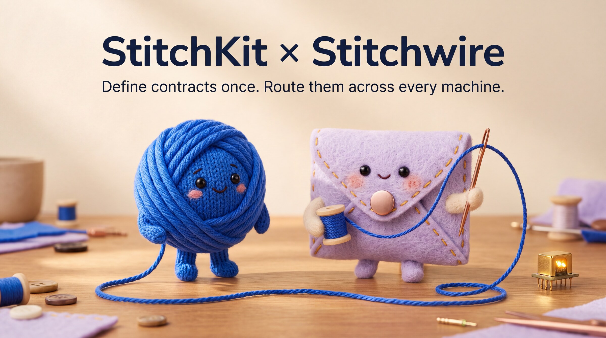

<p align="center">
  
</p>

<h1 align="center">Stitchwire</h1>

<p align="center">
  <strong>Broker-mediated typed RPC, bounded streams and volatile events between machines behind NAT.</strong><br/>
  No inbound node ports. No reverse SSH keys. No remote shell.
</p>

<p align="center">
  <a href="./LICENSE"></a>
  = 1.4.4" />
  = 22 | Bun >= 1.4.4" />
</p>

<p align="center">
  
</p>

<p align="center">
  <em>Agents need no inbound network ports. Each agent dials a trusted broker, which accepts the connection. Network connections require TLS. Plain HTTP is allowed on loopback. Local applications talk to the agent over a private <code>0600</code> Unix socket — directly over HTTP-over-Unix or through <code>@stitchwire/client</code>.</em>
</p>

```text
application → local Unix door → agent → trusted broker → agent → declared service
```

---

## Why

- **No inbound node ports.** Laptops, home servers and private VMs dial outbound over TLS to trusted brokers — no firewall holes, no reverse SSH tunnels, no remote shell. The agent refuses a plain `http:`/`ws:` broker URL anywhere but loopback, which is for local development.
- **Default-deny grants.** Operator-owned policy decides which caller can reach which target and operation. Service descriptors never grant access by themselves.
- **Honest delivery certainty.** Timeouts and cancellations report `unknown` delivery instead of silently replaying writes or masking missed events.
- **Private local `0600` door.** Applications talk to one local agent over a Unix domain socket and never manage daemons, keys or broker connections.

### The problem it solves

Connecting private machines usually turns into a tangle of reverse SSH tunnels, open firewall ports and fragile ad-hoc scripts. Stitchwire replaces that mesh with one outbound-only brokered transport for typed RPC, pull-driven bounded streams and volatile pub/sub events — while services keep full ownership of their schemas, data, durable journals and business rules.

<p align="center">
  
</p>

## Install

### Runtime (broker, agent & CLI — Linux and macOS)

Install the runtime from npm with Bun. The package includes the native lock-identity modules for macOS.

```bash
bun add -g stitchwire
# or run without installing:
bunx stitchwire --version
```

Or install the standalone bundle from GitHub Releases. It needs Bun already installed (https://bun.sh) and never installs it; it places `~/.local/bin/stitchwire` and, on macOS, `~/.local/native/darwin-<arch>.node`. The installer verifies the Ed25519 signature on `SHA256SUMS` against its embedded public key, checks the runtime and platform files, and runs the staged binary before replacing the current installation.

```bash
curl -fsSL https://raw.githubusercontent.com/max-listov/stitchwire/main/contrib/install.sh | bash
```

> **Platform note:** Stitchwire runtime supports **Linux** and **macOS** (Unix domain sockets `0600` + `systemd` / `launchd`). Windows runtime and browser transport are not supported.

### Typed client SDK (Node ≥22 or Bun ≥1.4.4)

Install the SDK in your application with Bun or npm.

```bash
bun add @stitchwire/client
# or
npm install @stitchwire/client
```

Importing the client does not start an agent: it talks to the one already running on the machine.

## Quickstart

Try the full isolated two-broker, two-agent typed service example locally (no external setup or fleet required):

```bash
git clone https://github.com/max-listov/stitchwire.git
cd stitchwire
bun install --frozen-lockfile --ignore-scripts
bun run example:service
```

Call a declared service from your application:

```ts
import { createWireClient, defaultWireSocketPath } from '@stitchwire/client';

// ~/.local/state/stitchwire/agent.sock unless STITCHWIRE_AGENT_SOCKET or STITCHWIRE_STATE_DIR is set.
using wire = createWireClient({ socketPath: defaultWireSocketPath() });
const result = await wire.invokeService({
  to: 'worker',
  service: 'example.catalog',
  revision: '1',
  operation: 'lookup',
  payload: JSON.stringify({ key: 'alpha' }),
  timeoutMs: 2_000,
});
```

## Four transport planes

| Plane | Purpose | Key invariants |
| --- | --- | --- |
| **Declared services** | Typed HTTP-over-Unix RPC & contract streams projected from [Stitchkit](https://github.com/max-listov/stitchkit) contracts | Default-deny per caller/target/operation; opaque owner payloads; explicit byte & timeout ceilings |
| **Fixed command profiles** | Constrained execution of operator-declared binaries | Fixed executable path and argv rules; never a caller-selected shell |
| **Bounded streams** | Live stdout/NDJSON/framed feeds across nodes | Pull-driven credit backpressure, explicit terminal reason, cooperative cancellation |
| **Volatile events** | Pub/sub fan-out with sequence continuity checks | Bounded in-memory retention, explicit gap & boot-change frames — never silent data loss |

Runnable examples: [service](examples/service/README.md) · [stream](examples/stream/README.md) · [events](examples/events/README.md).

## StitchKit × Stitchwire

<p align="center">
  
</p>

<p align="center">
  <em>Define a service contract once with <a href="https://github.com/max-listov/stitchkit">Stitchkit</a> — route it across every machine over Stitchwire.</em>
</p>

- **One contract, zero glue.** `serviceDescriptorFromContract()` derives operation IDs, exact static paths and stream framing directly from your Stitchkit contract.
- **Owner ingress & caller fetch.** Mount `createServiceIngress()` on a `0600` Unix socket on the owner machine and hand `createServiceFetch()` to your existing typed Stitchkit client on the caller — preserving cancellation, byte ceilings and `serviceCaller()` identity end to end.
- **Framework-optional.** The local door is plain HTTP-over-Unix, and `@stitchwire/client` works standalone without Stitchkit for raw `invokeService`, fixed command profiles, bounded streams and volatile events.

## Products and distribution

| Artifact | Source | Distribution |
| --- | --- | --- |
| Broker, agent & CLI runtime | `packages/runtime/src` | standalone GitHub Releases (`SHA256SUMS` + `contrib/install.sh`), and `stitchwire` on npm (`bun add -g stitchwire`); requires Bun ≥1.4.4 |
| Typed local client SDK | `packages/client/src` | GitHub Releases, and `@stitchwire/client` on npm (ESM + TypeScript declarations; Node ≥22 / Bun ≥1.4.4) |
| Shared transport contracts | `packages/contracts/src` | Internal workspace package (`private: true`), bundled into runtime and client |

Service templates live in `contrib/`:
- **Linux (`systemd`):** `contrib/systemd/stitchwire-agent.service`, `contrib/systemd/stitchwire-broker.service`
- **macOS (`launchd`):** `contrib/launchd/com.stitchwire.agent.plist` starts the agent through a `Stitchwire.app` launcher (`contrib/launchd/stitchwire-launcher.c`), so macOS attributes local-network access to Stitchwire. `bun scripts/macos-bundle.ts` builds that bundle from a source checkout and signs it only with your own Apple **Developer ID Application** identity. Without one, delete the launcher line from `ProgramArguments` and launchd runs Bun directly; macOS then attributes the agent's network access to Bun.
- **Broker TLS reverse proxy:** `contrib/nginx/stitchwire-broker.conf`

## Guarantees and deliberate limits

| Guarantee / Limit | Contract |
| --- | --- |
| **Trusted broker, no E2EE** | Brokers authenticate machine tokens by SHA-256 digest and can observe routed payloads |
| **Default-deny grants** | Service bindings and caller/target/operation grants are operator-owned; descriptors never grant access by themselves |
| **TLS on every network hop** | The agent refuses plain `http:`/`ws:` broker URLs outside loopback; loopback is for local development or a trusted local reverse proxy |
| **Honest delivery certainty** | Timeouts and cancellation can mean **unknown delivery** — never automatically replay uncertain writes |
| **Bounded streams** | Streams have explicit byte and time limits and a terminal reason; a quiet stream is not a dead one |
| **No durable broker queue** | Event retention is bounded and volatile; gaps are delivered explicitly so owners reconcile from their own durable state |
| **One fleet, one runtime version** | Brokers and agents enforce exact runtime version handshakes; mixed-version rolling upgrades are refused |
| **Local Unix door = local authority** | Any process allowed to open the `0600` agent socket has that node's local authority; per-user auth lives above Wire |

## Development and verification

```bash
bun install --frozen-lockfile --ignore-scripts
bun run check                # typecheck, Biome lint/format, full test suite
bun run build                # standalone dist/stitchwire + macOS native sidecars
bun run check:runtime-package # pack stitchwire runtime tarball and verify isolated install
bun run check:client-package # pack @stitchwire/client and verify on Node & Bun
bun run verify               # full local verification gate
```

On macOS, `bun run check` also compiles the launcher and builds the app icon, which needs `clang` (Xcode Command Line Tools), `iconutil` and `sips` (part of macOS) and `rsvg-convert` (`brew install librsvg`).

## Documentation

- [Vision](docs/VISION.md) — product direction and deliberate limits
- [Architecture and packaging](docs/architecture/product.md) — runtime, broker, agent and planes
- [Distribution and installation](docs/architecture/distribution.md) — artifacts, macOS/Linux supervision and removal
- [Local node enrollment](docs/architecture/enrollment.md) — repeatable admission, binding and detach
- [Diagnostics](docs/architecture/diagnostics.md) — bounded `stitchwire doctor --json`, with the same checks and exit status as text mode; scheduling stays with the operator
- [Publication inputs](docs/architecture/publication.md) — clean history-free snapshots and release gates
- [Architecture Decision Records](docs/decisions/) — why each protocol boundary exists
- [Security policy](SECURITY.md) · [Contributing](CONTRIBUTING.md) · [Changelog](CHANGELOG.md)

## License

[MIT](./LICENSE) © Max Listov
